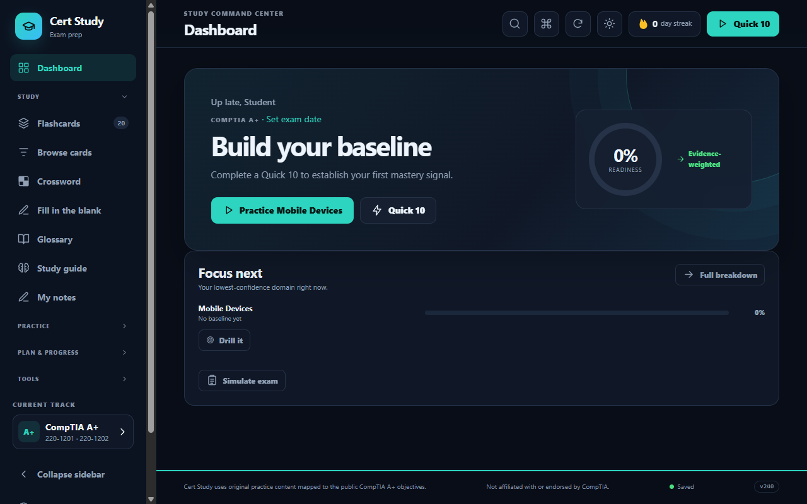
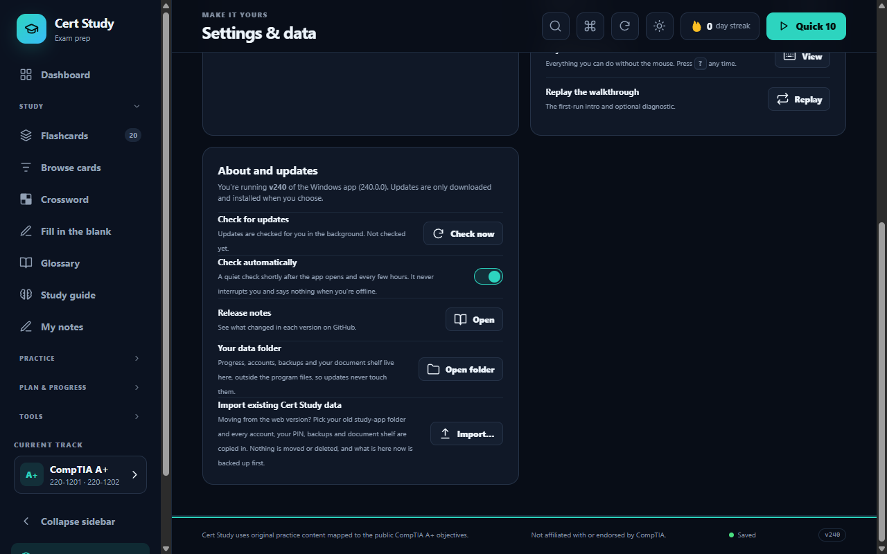

# Cert Study

An offline study app for IT certifications. Practice questions, spaced-review flashcards, hands-on
labs, study guides, mock exams, a study planner, and a set of small admin tools, all running on your
own computer. Your progress stays in files on your machine.

Tracks included: CompTIA A+ (Core 2), Network+, Security+, 3CX (Basic and Advanced), Windows Server
hybrid (AZ-802), Azure SQL (DP-300), and Blender Fundamentals.





## Get it for Windows

1. Open the [latest release](https://github.com/Nexus-Primes/IT-Certification-Study-App/releases/latest) and download `Cert-Study-Setup-….exe`.
2. Run it. It installs just for you, with no administrator prompt, and opens when it finishes.

**Windows may warn you.** The installer is not code-signed yet, so SmartScreen can say "Windows
protected your PC / unknown publisher". That is expected for a small free app. Choose **More info**,
then **Run anyway**. You can check the download against the code in this repository, which is all
public.

Requires Windows 10 or 11 (64-bit). It is a normal Windows program with its own window, Start menu entry and uninstaller. You do **not** need Python, a web browser, or anything else installed, and it works fully offline. (The Python script and the browser version below are only for people who want to run it from source.)

## Updates

Updates come to you **inside the app**; nobody has to visit GitHub again after the first download. Open **Settings, About and updates** (or **Help, Check for updates** in the window menu). The app quietly checks GitHub a few seconds
after it starts and every few hours (you can turn this off, and it says nothing when you are
offline). If a newer version exists you are told, shown what changed, and **nothing is downloaded or
installed until you click**. Before installing, the app backs up your data folder. Updates replace
only the program files, never your progress.

## Where your data lives

The Windows app keeps everything in `%APPDATA%\Cert Study\` (Settings has an **Open folder**
button): progress for each account, the account list and PIN, automatic backups, and the document
shelf. Uninstalling the app leaves this folder alone.

Coming from the web version? Settings has **Import existing Cert Study data**: pick your old
`study-app` folder and every account, PIN, backup and shelf file is copied in (never moved).
**Back up everything** does the reverse, copying your whole setup into a dated folder, for example on
a USB drive. In the Document shelf, **Add files** (or dragging files onto the window) copies
documents in.

## Run it from source

Web version (Python 3.9 or newer, no packages needed):

```
python server.py
```

Then open http://localhost:8420.

Desktop version (Node.js 24 LTS):

```
npm install
npm start
```

Tests: `python tests/run.py` (the full browser suite, about 16 minutes, needs Edge or Chrome) and
`npm run test:desktop`. See [CLAUDE.md](CLAUDE.md) for the rules and [RELEASING.md](RELEASING.md) for
how a release is made.

## Please read

- This is an **unofficial** study aid. It is **not affiliated with or endorsed by** CompTIA, Microsoft,
  3CX, or the Blender Foundation. Those names belong to their owners.
- The practice questions are **original**. They are **not real exam questions** and not from any
  braindump.
- Some content was written from general knowledge and checked as far as possible against the public
  exam objective lists. The app says so where it matters. Always confirm important details against
  the vendor's current documentation and objectives, and do not treat a practice score as a
  prediction of a real exam result.
- Exam objectives and products change. If you find something wrong, please open an issue.

## License

No license has been chosen yet. Until one is added, the code is visible here but all rights are
reserved by the author.

## Reporting problems

See [SECURITY.md](SECURITY.md).
